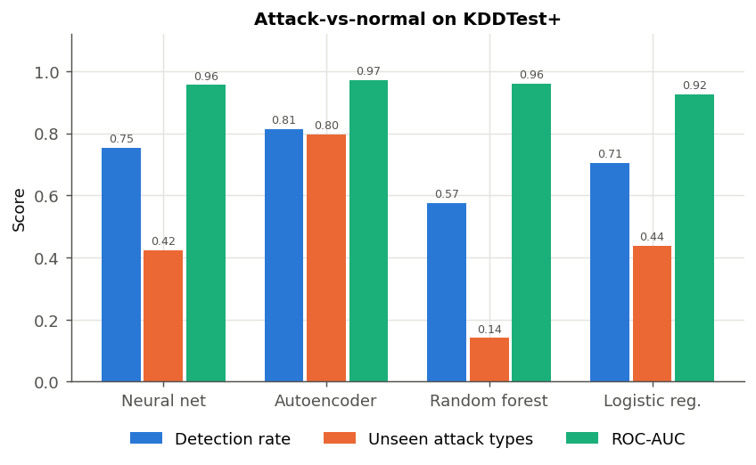
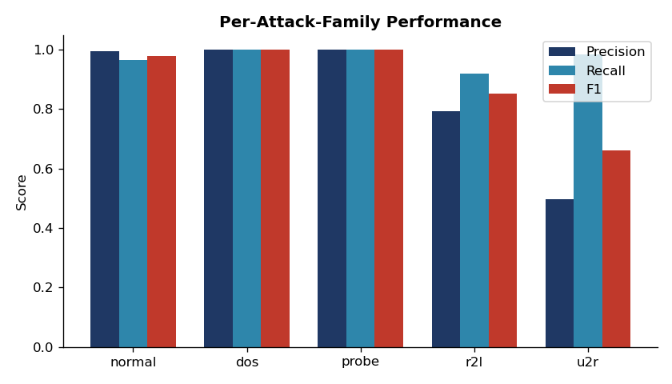
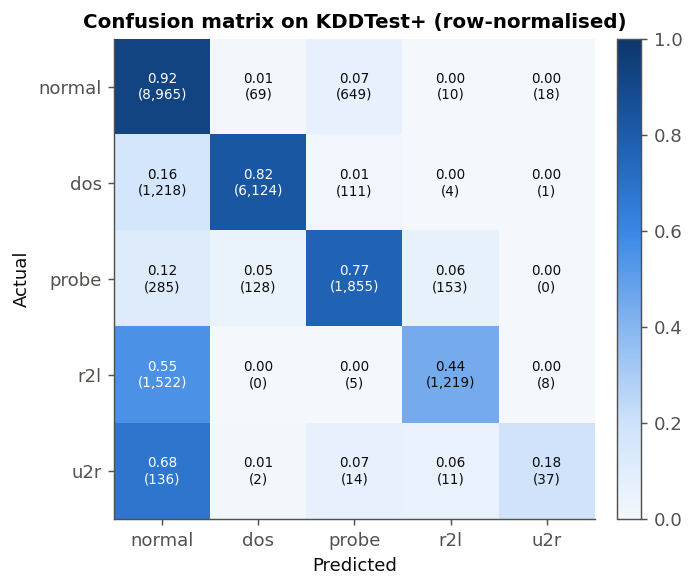
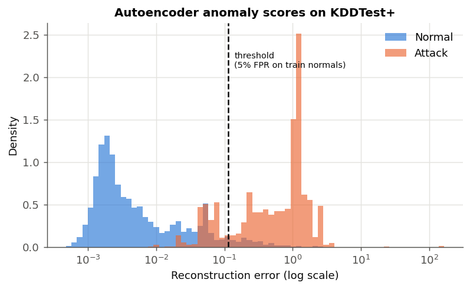
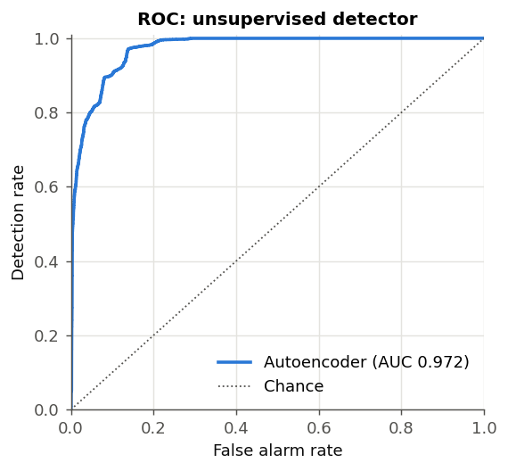

# Network Intrusion Detection with Deep Learning

[](https://github.com/Ehsan-Ghoreishi/network-intrusion-detection/actions/workflows/ci.yml)


Two complementary detectors trained and evaluated on the real **NSL-KDD**
benchmark:

- a **supervised neural network** that classifies connections into `normal`
  or one of four attack families, and
- an **unsupervised autoencoder** that learns only what normal traffic looks
  like and flags anything it cannot reconstruct.

The project's central result: on the 17 attack types in the test set that
**never appear in training**, the autoencoder catches **79%** of them. The
supervised network catches 36% and a random forest 14%. That is the practical
argument for anomaly-based detection of zero-day attacks, measured instead of
asserted.

> Built by **Seyedmohammad (Ehsan) Ghoreishi**.

---

## Results

All numbers are on the official **KDDTest+** split (22,544 connections),
after training on **KDDTrain+** (125,973 connections). The deep models are
reported as **mean ± std over 5 seeds** (`nids robustness`). The baselines
are deterministic.

| Model | Detection rate | False alarm rate | ROC-AUC | Unseen attack types detected |
|---|---|---|---|---|
| **Autoencoder** (unsupervised) | **82.1% ± 2.9** | **5.4% ± 0.2** | **0.970 ± 0.004** | **78.8% ± 0.4** |
| Neural network (supervised) | 70.8% ± 3.1 | 7.9% ± 0.5 | 0.933 ± 0.016 | 36.2% ± 4.4 |
| Logistic regression | 70.5% | 9.5% | 0.925 | 43.8% |
| Random forest | 57.5% | 2.6% | 0.959 | 14.1% |

*Detection rate* is recall on attacks; *false alarm rate* is the share of
normal traffic flagged. "Unseen attack types" covers the 3,750 test
connections whose attack label (e.g. `mailbomb`, `snmpguess`, `apache2`)
does not exist in the training data.



*Figure: one representative run (seed 42); the table above gives the spread.*

### Why test scores are lower than you might expect

Validation accuracy on held-out *training* data is **99%**. Test accuracy for
the supervised network is **77.5% ± 1.9** (multi-class, macro-F1 0.61 ± 0.04).
The gap is a property of NSL-KDD, not a bug: KDDTest+ was deliberately built
with a different class mix, harder records and new attack types. Published
deep-learning results on this split sit in the same 75–85% range. Projects
that report 99% on NSL-KDD almost always evaluate on a random split of the
training file, which leaks the attack types into the test set.

The project's first version made that mistake in an extreme form: it trained on
synthetic data, which is why its old README showed 99.3% detection.

---

## Model 1: Supervised neural network

```
input (121)  ->  Dense(128) BN ReLU Dropout(0.3)
             ->  Dense(64)  BN ReLU Dropout(0.3)
             ->  Dense(5) softmax
```

- **Class weighting.** `u2r` is 52 of 125,973 training rows (0.04%), so the
  loss uses inverse-frequency weights. Capping those weights at 3, 10 or 50
  made no difference beyond seed noise, so they stay uncapped.
- **Early stopping** on a stratified 10% validation split with best-weights
  restore.
- **Batch normalisation + dropout** for stable training on 121 mixed-scale
  features.




The confusion matrix shows where supervised detection fails: **55% of `r2l`
and 68% of `u2r` test attacks are classified as normal**. There are two
different causes:

- **Unseen types.** 93% of missed `u2r` rows are `httptunnel`, which is absent
  from training. The unseen `snmpguess` and `snmpgetattack` attacks are missed
  almost completely (508 of 509 rows).
- **Distribution shift within a seen type.** `guess_passwd` has 53 training
  rows but 1,231 test rows, and 62% of those are missed. The model has seen
  the attack, just far too little of it.

## Model 2: Autoencoder anomaly detector

```
input (121) -> 64 -> 32 -> [8] -> 32 -> 64 -> output (121)
               \_ encoder _/  bottleneck  \_ decoder _/
```

Trained **only on normal training connections**, so it never sees an attack
label. The anomaly score is mean squared reconstruction error.

**No test-set leakage in the threshold.** The alert threshold is set at the
95th percentile of error on a held-out 20% of *training* normals, i.e. a
target false-alarm rate of 5%. On the test set it lands at 5.4%, which shows
the calibration transfers. (The first version of this project picked the
threshold using test data.)




| Attack family | Detected by autoencoder | Detected by supervised NN |
|---|---|---|
| DoS | 88.8% | 83.7% |
| Probe | 98.3% | 88.2% |
| R2L | 46.4% | 44.7% |
| U2R | 83.0% | 32.0% |

*(seed 42; binary attack-vs-normal detection per family)*

R2L remains the hard case for both models: password guessing and SNMP
attacks look like ordinary logins at the connection level, so payload or
host data is needed to catch them reliably.

---

## Data

[NSL-KDD](https://www.unb.ca/cic/datasets/nsl.html) (Tavallaee et al., 2009)
is the cleaned successor to KDD Cup 99, with duplicate records removed and
a harder test set. `nids download` fetches it from a public mirror and
**verifies each file's SHA-256** before use.

| Split | Rows | Attack share | Attack types |
|---|---|---|---|
| KDDTrain+ | 125,973 | 46.5% | 22 |
| KDDTest+ | 22,544 | 56.9% | 37 (17 unseen) |

Preprocessing (`src/nids/features.py`, a single scikit-learn
`ColumnTransformer` fitted on training data only):

- one-hot encoding of `protocol_type`, `service` and `flag`, with unknown
  categories ignored rather than crashing at inference;
- `log1p` followed by standardisation for 12 heavy-tailed count and byte
  features;
- standardisation for the remaining numeric features;
- `num_outbound_cmds` dropped (it is zero in every row).

**Limitations.** NSL-KDD traffic dates from 1998 and has known simulation
artefacts. It is the standard benchmark for comparing methods, but it is not
evidence of performance on modern networks. A natural next step is
CIC-IDS2017 or UNSW-NB15. See [docs/MODEL_CARD.md](docs/MODEL_CARD.md).

---

## Run it

```bash
git clone https://github.com/Ehsan-Ghoreishi/network-intrusion-detection.git
cd network-intrusion-detection
python -m venv .venv && source .venv/bin/activate
pip install -e ".[dev]"          # or: pip install -r requirements.txt for exact versions

nids download                    # fetch + checksum NSL-KDD into data/
nids supervised                  # train + evaluate the classifier
nids autoencoder                 # train + evaluate the anomaly detector
nids baselines                   # logistic regression + random forest
nids robustness --seeds 5        # mean ± std over seeds
nids plots                       # regenerate every figure in reports/
```

`make all` runs the full pipeline; `make test` and `make lint` run the checks
that CI runs. The full pipeline takes about 5 minutes on a laptop CPU.

## Project structure

```
src/nids/
├── config.py       # paths, NSL-KDD schema, feature groups
├── attacks.py      # 39 attack labels -> 4 families
├── data.py         # download with checksum, load splits
├── features.py     # preprocessing pipeline
├── models.py       # Keras classifier + autoencoder
├── metrics.py      # SOC-style metrics, seen/unseen breakdown
├── supervised.py   # train/evaluate classifier
├── anomaly.py      # train/evaluate autoencoder
├── baselines.py    # classical baselines
├── robustness.py   # multi-seed evaluation
├── plots.py        # figures
└── cli.py          # `nids` command
tests/              # 39 tests, no network access needed
reports/            # committed metrics (JSON) and figures
docs/MODEL_CARD.md  # intended use, limitations
```

## Tech stack

`Python` · `TensorFlow / Keras 3` · `scikit-learn` · `pandas` · `NumPy` ·
`Matplotlib` · `pytest` · `ruff` · `GitHub Actions`

## References

- M. Tavallaee, E. Bagheri, W. Lu, A. Ghorbani. *A Detailed Analysis of the
  KDD CUP 99 Data Set.* IEEE CISDA, 2009.
- R. Chalapathy, S. Chawla. *Deep Learning for Anomaly Detection: A Survey.*
  arXiv:1901.03407, 2019.

## License

MIT, see [LICENSE](LICENSE).
