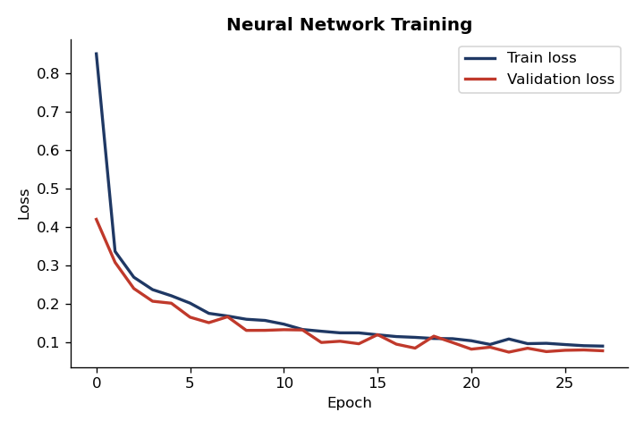

# Network Intrusion Detection with Deep Learning

Two complementary deep-learning models that detect network attacks: a
**supervised neural network** that classifies known attack families, and an
**unsupervised autoencoder** that catches *unknown* (zero-day) attacks by
spotting anomalies. Built on the feature structure of the **NSL-KDD**
benchmark, the standard dataset for intrusion-detection research.

> Built by **Seyedmohammad (Ehsan) Ghoreishi** — combining data science with a
> genuine interest in cybersecurity. This project demonstrates applied deep
> learning for security: multi-class classification, anomaly detection, and
> the reasoning behind each design choice.

---

## Why two models?

A real intrusion-detection system faces two different problems, and this
project solves both:

| Model | Question it answers | Approach |
|---|---|---|
| **Supervised NN** | "Is this one of the attacks we *know* about?" | Learns from labelled attacks |
| **Autoencoder** | "Is this *anomalous*, even if we've never seen it?" | Learns only what *normal* looks like |

The second is the more advanced idea: a supervised model can only detect
attacks it was trained on, but real threats include zero-days nobody has
labelled yet. The autoencoder catches those.

---

## Model 1 — Supervised neural network

A feed-forward network classifies each connection as `normal` or one of four
attack families (`dos`, `probe`, `r2l`, `u2r`).

```
input (12 features)
  -> Dense(64) + ReLU + Dropout(0.3)
  -> Dense(32) + ReLU + Dropout(0.3)
  -> Dense(5)  + softmax
```

**Results (held-out test set):**

| Metric | Value |
|---|---|
| **Attack detection rate** | **99.3%** |
| False alarm rate | 3.5% |
| Overall accuracy | 97.8% |



Per-family performance shows an honest, real-world story: DoS and probe
attacks are caught perfectly, while `u2r` (privilege escalation) — only 1% of
traffic and the hardest, most dangerous class — is much harder to pin down.


**Techniques used and why they matter:**
- **Dropout** — randomly disables neurons during training so the network
  generalises instead of memorising.
- **Class weighting** — `u2r` attacks are 1% of data; without weighting the
  network would ignore them. Weighting forces it to care about rare attacks.
- **Early stopping** — halts training when validation loss stops improving,
  preventing overfitting.
- **Feature scaling + log transforms** — neural nets train poorly on raw,
  heavy-tailed network counts.

---

## Model 2 — Autoencoder for anomaly detection

An autoencoder is trained to **reconstruct its own input** through a
bottleneck. We train it **only on normal traffic**, so it becomes excellent at
rebuilding normal connections and terrible at rebuilding anything anomalous.
High reconstruction error = likely attack.

```
input (12) -> Dense(8) -> Dense(4)  [bottleneck]  -> Dense(8) -> output (12)
              \____ encoder ____/    \____ decoder ____/
```

**Results:**

| Metric | Value |
|---|---|
| **ROC-AUC** | **0.992** |
| Attack detection rate | 97.3% |
| False alarm rate | 5.0% |
| Reconstruction error (attack vs normal) | **56× higher** |

The separation is striking — attacks reconstruct with 56× the error of normal
traffic, which is exactly what makes the anomaly threshold work:


This is the same principle behind modern anomaly-based IDS and fraud systems:
learn "normal" deeply, then flag anything that deviates.

---

## What the attack families look like

The synthetic data reproduces the real behavioural signatures of each attack:

| Family | Signature |
|---|---|
| **DoS** | Flooding — huge connection counts, tiny replies, high error rates |
| **Probe** | Scanning — touches many different services and hosts, short connections |
| **R2L** | Remote-to-local — normal-looking but with repeated failed logins |
| **U2R** | Privilege escalation — rare, involves root shells after login |

---

## Project structure

```
network-intrusion-detection/
├── src/
│   ├── generate_data.py    # NSL-KDD-style synthetic traffic
│   ├── supervised_nn.py    # multi-class neural network classifier
│   ├── autoencoder.py      # unsupervised anomaly detector
│   └── make_plots.py       # all figures
├── reports/                # metrics + figures + saved model
├── data/                   # generated dataset
├── requirements.txt
└── README.md
```

> **Note on data:** genuine labelled attack traffic is licence-restricted and
> sensitive, so this repo generates synthetic traffic matching the statistical
> fingerprints of the NSL-KDD attack families. The deep-learning pipeline is
> identical to what runs on the real dataset — only the data source changes.

---

## Run it

```bash
pip install -r requirements.txt

python src/generate_data.py     # create the dataset
python src/supervised_nn.py     # train + evaluate the classifier
python src/autoencoder.py       # train + evaluate the anomaly detector
python src/make_plots.py        # all figures
```

---

## Tech stack

`Python` · `TensorFlow / Keras` · `scikit-learn` · `pandas` · `NumPy` · `Matplotlib`

## Skills demonstrated

Deep learning (feed-forward networks, autoencoders) · multi-class
classification · unsupervised anomaly detection · handling class imbalance ·
regularisation (dropout, early stopping) · model evaluation · applied
**cybersecurity** domain knowledge — a foundation for AI-driven security and
anomaly detection work.
